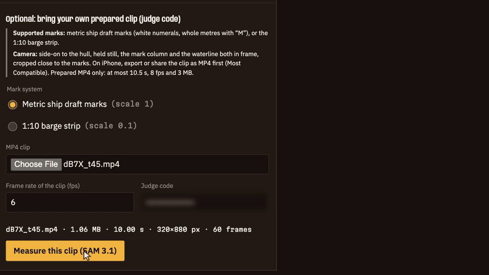

<div align="center">
  
  <h1>DraftMark ⚓</h1>
  <p><em>Time-average the waterline from a short video of a ship's draft marks, then let an agent write, prove and run the survey program.</em></p>
  

  <br/>

  [](https://draftmark.edycu.dev)
  [](https://youtu.be/9vRaziU6X1g)
  [](https://draftmark.edycu.dev/evidence)
  [](https://draftmark.edycu.dev/deck)
  [](https://cerebralvalley.ai/e/meta-ai-developer-hackathon)

  <br/>

  
  
  
  
  [](https://github.com/edycutjong/draftmark/releases)
  [](LICENSE)

</div>

---

## 📸 See it in Action

<p align="center">
  
</p>
<p align="center"><sub>Cut from one continuous real take of the live site (2026-11-01): only the two model waits are sped up, and both are labelled on screen.</sub></p>

<p align="center">
  
</p>

Try it at **https://draftmark.edycu.dev** (the landing replays the real dB7X waterline): the committed example runs at
[/runs](https://draftmark.edycu.dev/runs) replay real SAM 3.1 and Spark 1.3 output (labelled as recorded runs); the
Wonder self-test re-runs live, with no code, on [/runs](https://draftmark.edycu.dev/runs#program-h) and in step 1 of
[/survey](https://draftmark.edycu.dev/survey); uploading your own prepared clip needs a judge code.

## 💡 The Problem & Solution

### The Problem

A draft survey weighs a bulk cargo from the six painted draft marks on a hull: read the waterline, convert to
displacement through the ship's hydrostatic booklet, subtract ballast, fuel and constants. The reading is the weak
step: the sea moves across the numerals and the surveyor eyeballs a mean. The paperwork after it is a per-ship
spreadsheet. A P&I club's guide expects "a well-conducted draught survey of a large vessel" to be accurate "to within
0.5%" ([North of England P&I, *Draught Surveys: A Guide to Good Practice*](https://www.amnautical.com/products/draught-surveys-a-guide-to-good-practice-second-edition));
on an illustrative 60,000 t cargo that is 300 t, and on our test booklet 1 cm of draft at 6.5 m is 36.99 t. That 0.5 % is
the guide's bar, not our result: on clip dB7X the stated figure is repeatability (±0.086 m), and a one-pitch label miss
would move the draft 0.20 m. Nearby tools exist as far as we saw in public material (named, not from a systematic prior-art search; no benchmark against them is claimed) (Excel draft-survey
calculators and apps, academic draft-line readers, laser/radar draft systems, "draft tube" practice); DraftMark does not claim to replace a surveyor's document.

### The Solution

Three steps, each with a check that is code, not a model's opinion:

1. **Measure.** SAM 3.1 segments the numerals and the water in a prepared video clip; Muse Spark 1.3 reads the painted
   strings; five code checks (monotone, pitch, fit residual, two-frame agreement, wide-glyph anchor) must all pass
   before a label is used. The draft is averaged over the clip with MAD outlier rejection and a repeatability
   uncertainty.
2. **Prove a program.** Muse Wonder 1.0 writes the per-ship survey program from the booklet. It is accepted only
   after it reproduces at least 90 % (20 of 22) of the booklet's own printed worked conditions within 0.1 % (the shipped program reproduces 22/22), runs in a no-network sandbox and refuses to
   extrapolate outside the table.
3. **Certify.** The certificate is built by code and prints code values only and refuses (`REFUSE`) when a
   check fails. Each station's output carries an HMAC; if any was edited the certificate is `REFUSE UNSIGNED`. The HMAC
   guards the prototype's own chain; it is not a legal signature, and it does not authenticate the clip's source or
   the uploader, or stop a complete valid run being replayed within its 24 h.

Day-one output: a pre-read with its repeatability, the five label checks, which positions were filmed and which
entered, the model response ids, and a refusal reason when there is one; before an official survey, not instead of it.

What exists vs what is new: the calculators, readers and laser systems above exist. What we demonstrate, without
claiming others lack it, is the combination: a wave-averaged reading from a video clip plus an agent that writes
the survey program and must reproduce the booklet's printed conditions with it before it computes, with refusal enforced by code.

## 🏗️ Architecture & Tech Stack

<p align="center">
  
</p>

One Next.js app on Vercel plus one Python FastAPI function that holds every model call and every number. No
database; the browser carries each station's HMAC-signed output to the next, and each station verifies the previous
one's HMAC with a key that never leaves the server (tokens expire after 24 h): an edited geometry is refused (400
`UNSIGNED`) before any model call, and a survey that claims a measured clip without a valid chain is certified `REFUSE UNSIGNED`. Full write-up: [docs/ARCHITECTURE.md](docs/ARCHITECTURE.md).

```
prepared clip (port midship only) --> /measure (SAM 3.1) --> /labels (Spark 1.3 + 5 code checks) --> /draft (least squares)
              --> /survey (other five drafts typed in; proven Wonder program, one sandbox launch)
              --> certificate (code values only, or REFUSE)
```

| Layer | Choice |
|---|---|
| Frontend | Next.js 15, React 19, TypeScript |
| Backend | FastAPI on Vercel Python functions (`api/`) |
| Models | `sam-3.1`, `muse-spark-1.3`, `muse-wonder-1.0` (Standard models only) |
| Sandbox | AST gate, `python -I -S` subprocess, rlimits, audit hook, no network |
| Hosting | Vercel Hobby, no database, no object store |

## 🏆 Meta Model API Integration

| Model | What it does here | Code |
|---|---|---|
| SAM 3.1 (video) | "white number" and "water" concepts on a cropped mark column; masks decoded with `meta-sam-parser` | `api/index.py` (calls), `api/_core/sam.py` (mask decode), `api/_core/marks.py` (token grouping) |
| Muse Spark 1.3 | strict JSON-schema label reads on two frames at least 1 s apart (a `?` enum lets it abstain) | `api/_core/labels.py` |
| Muse Wonder 1.0 | writes the survey program; regenerated on failing conditions | `scripts/spike_wonder_program.py`, `api/_core/selftest.py`, `evidence/selftest-booklet.md` |

Not in the product flow: an offline Muse Spark 1.3 computer-use spike that files a report on our own labelled demo portal (read-back 6/6, an injected fault rejected): `api/_core/cu.py`, `evidence/cu-runs.md`.

Friction we met and what we did about it: [docs/DX-REPORT.md](docs/DX-REPORT.md). Meta calls are logged with a price-list cost estimate (not an invoice) in [evidence/api-usage.md](evidence/api-usage.md).

## 📊 Engineering Rigor

| Measure | Result | Evidence |
|---|---|---|
| Tests | 235 pytest passing, 100% statement coverage of `api/` (CI gate); 6 Playwright E2E specs | `tests/`, `e2e/` |
| Wonder program self-test | 22/22 printed booklet conditions, 2 regenerations (reference 22/22, verbatim copy 14/22, generic 0/22) | [selftest-booklet.md](evidence/selftest-booklet.md) |
| Survey on Trieste condition 4.1 | 17825.8 t vs printed 17827.7 t (-0.0106 %; one of the 22 acceptance rows, not held out) | [core-run-trieste.md](evidence/core-run-trieste.md) |
| Real clip dB7X | 60/60 frames, draft 12.761 m, u_rep 0.086 m (repeatability only) | [core-run-dB7X.md](evidence/core-run-dB7X.md) |
| Real clip UKTRQ | 46/48 frames, draft 20.830 m, u_rep 0.055 m | [core-run-UKTRQ.md](evidence/core-run-UKTRQ.md) |
| Synthetic error model (100 seeds) | truth inside ±2u in 96 %, RMSE 0.519 mm | [error-model-synthetic.md](evidence/error-model-synthetic.md) |
| Synthetic barge, 12 rendered loads (SAM numerals + Spark labels live, water mask a stand-in) | 12 of 12 loads within ±2 % of the synthetic truth; median error 0.12 %, p90 0.42 %, worst 0.75 % | [eval-synthetic.md](evidence/eval-synthetic.md) |
| Synthetic barge, one run | draft -0.155 mm vs synthetic truth | [core-run-synth-barge.md](evidence/core-run-synth-barge.md) |

### Attacks defeated

| Control | Why load-bearing | Test |
|---|---|---|
| Generated code in a sandbox | the model's program never runs in the server process | `tests/test_sandbox.py` |
| Signed station chain | an edited measurement is certified `REFUSE UNSIGNED` | `tests/test_endpoints.py` |
| Label checks | an unconfirmed or inconsistent label is never used (clip eeLL was refused by them, see `evidence/sam-real-clips.md`) | `tests/test_marks.py` (anchor / merged box) |
| Out-of-table refusal | the program raises rather than extrapolate the hydrostatic table | `tests/test_survey.py` |

### Honest limits (6)

1. The weight check is on 12 loads of a rendered **synthetic** barge (code-drawn pixels, truth by physics), not a physical scale: it checks the chain's arithmetic, label checks and wave-averaging, not real water, glare or a real print. SAM finds the rendered numerals but returned 0 water masks on all 12 clips, so the water edge there is a colour threshold on our own pixels. The eval also ran on the same loads that exposed three code fixes (in-sample for those). No real-ship photo set was verifiably open, so none was run ([eval-dataset.md](evidence/eval-dataset.md)).
2. The real-ship clips are third-party test footage with no ground truth (repeatability and refusal only, no accuracy claim); no real-ship draft accuracy is claimed.
3. The test booklet is a Ro-Ro/passenger ship, not a bulk carrier; a draft outside its 0.5-9.3 m table is refused, so the two real clips certify as `REFUSE OUT_OF_TABLE`; the range check does not verify that a clip and a booklet belong to the same vessel (the operator must).
4. Ship uncertainty is wave-averaging repeatability only (±0.086 m on clip dB7X's 10 s of swell: a spread, not an accuracy, and too wide to carry a cargo figure yet); real ships have no absolute calibration.
5. A consistent whole-metre misread passes the geometry checks by construction, so the user confirms the anchor crop on every live run.
6. A clip reads only the port midship mark; other positions are entered by hand and printed as entered. This is a prototype, not a surveyor's document.

Credit: a sandbox escape via `re.enum.sys` (found in our own adversarial testing, fixed in `1a1d7c1`) and a format-string attribute walk (banned after architecture review round 2, `233b9a8`; reviewers included Muse Wonder 1.0, logged in `evidence/api-usage.md`) are kept as regression tests in `tests/test_sandbox.py`. Other findings are fixed and listed in the commit log.

## 🚀 Getting Started

### Prerequisites

Node 20+, Python 3.11+, a Meta Model API key (`MODEL_API_KEY`; optional `MODEL_API_BASE`).

### Installation

```bash
npm install && pip install -r requirements.txt -r requirements-dev.txt ruff
export MODEL_API_KEY=...   # never commit it
npm run dev                # Next.js on :3000, FastAPI on :8000
```

## 🧪 Testing & CI

```bash
python3 -m pytest -q --cov=api   # 235 tests, 100% coverage of api/
ruff check . && npm run typecheck && npm run build
npx playwright test        # 6 E2E specs on the production build
```

`ci.yml` is a 6-stage pipeline:

| Stage | Job | What it runs |
|---|---|---|
| 1 | Frontend Quality | `tsc` on Node 20 / 22 / 24 (main) |
| 1 | Backend Quality | ruff, pytest with a 100% `api/` coverage gate |
| 2 | Secret Scanning | gitleaks over the full history |
| 2 | Dependency Audit | `npm audit` (production), `pip-audit` |
| 3 | Build Verification | `next build`, bundle budget, landing/deck number check |
| 4 | E2E Tests | Playwright on the built app |
| 5 | Performance | Lighthouse CI on `/` and `/runs` (accessibility >= 0.9 gates) |
| 6 | Deploy Gate | all stages green on `main` |

Then `deploy.yml` cuts a semantic-version GitHub release from Angular commit messages (`feat:` minor, `fix:` patch, `!` major) and deploys that version to Vercel; the landing page and deck show it. `codeql.yml` scans Python + TypeScript; Dependabot covers npm, pip and Actions.

## 📁 Project Structure

```
app/ components/ lib/   Next.js UI: survey flow, certificate, evidence page
api/                    FastAPI function and api/_core (measure, marks, survey, sandbox, sign, limits)
data/                   booklet data with citation
evidence/               every number in this README, as a run record
tests/ scripts/         pytest suite; spikes and run scripts
docs/                   ARCHITECTURE, DX report, brand assets
```

## 📽️ Demo Materials

Live: https://draftmark.edycu.dev · Evidence page: https://draftmark.edycu.dev/evidence

## 📄 License

MIT, see [LICENSE](LICENSE).
